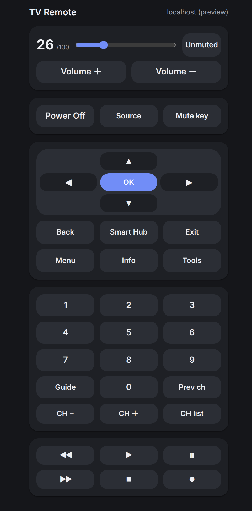

# Samsung TV web remote

A phone-friendly web remote for rooted Samsung **Orsay** TVs (H/J series).
The TV hosts the page and its API itself, so there is no computer to keep
running: copy the app to the root USB stick, root the TV, and open
`http://<tv-ip>:1080/remote/` from any phone on the same Wi-Fi.

Tested on a **Samsung UE48J5248** (J5200 family, 2015, firmware
`T-N14MJDEUC-1150.0`) rooted with the SamyGO **H "Network" root**.

<p align="center">
  
</p>

> **Rooting is unofficial and can brick the TV.** Read
> [ROOT-PLAN.md](ROOT-PLAN.md) before you start. The root lives on a USB stick
> that must stay plugged in.

## Compatible TVs

| TV / firmware | Status |
|---|---|
| **UEXXJ5248** (J5200), `T-N14MJDEUC-1150.0` | Tested: root + web remote |
| **UEXXJ5200**, `T-N14MJDEUC-1121.0` | Same root method reported working; remote untested |
| Other **H-series** (2014) and **J-series Orsay** sets in the H Network root's firmware window | Root may work; the remote is untested. Use the matching image/`run1.sh`; this repo ships the NT14M/NT14MJDEUC files. |
| **Tizen** (2016+ K/M/Q/R/T) and **T-GFS** | Not supported |

The web remote itself has only been tested on the UE48J5248. Keys are Orsay
`samyGOrc` codes and volume uses the TV's UPnP renderer, so other rooted Orsay
sets should work, but the key map and renderer path may need adjusting.

## What's in this repo

| Path | What it is |
|---|---|
| `remote/` | Page + PHP API.  |
| `samygo/` | USB payload: `SamyGO/`, `InstallSamyGO-H/`, `newvdfs.img`; the bundled `run1.sh` links Apache to `USB/remote` |
| `ROOT-PLAN.md` | Detailed rooting, fallbacks, recovery |
| `GOTCHAS.md` | TV quirks and verified facts |

## Before you start

- **Brick risk is real.** This is a community procedure, not an official one.
  Read [ROOT-PLAN.md](ROOT-PLAN.md) first.
- **The root USB must stay plugged in.** Removing it while the TV is on can
  freeze the TV; removing it while off only loses root until you plug it back.
- **Use Wi-Fi** for the Network root (not Ethernet).
- **FAT32 USB stick.** A second USB stick acting as a recording device helps
  on some sets.
- On the TV, turn **off**: `Samsung Instant ON`, `Quickly Power OFF`, and
  `Smart Hub → Auto update apps`.
- In the **service menu**, turn **off Watchdog** and **OTN support** (block
  updates at the router if OTN is greyed out). 
- **Do not factory reset** and **do not install a firmware update** after
  rooting.

## 1. Prepare the USB

The repo contains everything; 

1. Format the USB stick as **FAT32**.
2. Copy these to the **USB root**:

   ```
   samygo/InstallSamyGO-H/   ->  InstallSamyGO-H/
   samygo/SamyGO/            ->  SamyGO/
   samygo/newvdfs.img        ->  SamyGO/newvdfs.img
   remote/*                  ->  remote/
   ```
   You should end up with:

   ```
   USB/
     InstallSamyGO-H/
     SamyGO/
       newvdfs.img
       run1.sh
     remote/
       index.html
       api/
       lib/
   ```


## 2. Root the TV

Detailed steps in [ROOT-PLAN.md](ROOT-PLAN.md).

## 3. Open the remote

After the TV boots, open on your phone:

```
http://<tv-ip>:1080/remote/
```

## Updating the remote

The TV reads the app from the USB:

1. Power the TV off.
2. Unplug the root USB and connect it to the computer.
3. Copy the new `remote/` contents over `USB/remote/`.
4. Replug and power on. 

Do not unplug the root USB while the TV is on.


## How it works (short version)

The app lives on the USB root at `remote/`. The patched `SamyGO/run1.sh`
creates `/mnt/var/www/remote` as a symlink to it after mounting the root image.
Apache (`/dtv/www` -> `/mnt/var/www`) follows the symlink, so the page and PHP
API come straight from the USB.

Keys are sent with `samyGOrc`; volume is read over UPnP from the TV's own
renderer on port 7676, and changed with `samyGOrc` keys because the renderer
ignores volume *writes* from the TV's own IP.
The key table is in [`remote/lib/keys.php`](remote/lib/keys.php) and may need adaptation for your specific model

## Troubleshooting

| Symptom | Check |
|---|---|
| Page returns 404 | Does `USB/remote/index.html` exist? Run `ls -l /mnt/var/www/remote`; it should point to `/dtv/usb/sdX/remote`. |
| App changes not showing | Copy the new files to `USB/remote/`; the symlink is live, no reboot needed. ||
| Root lost after a reboot | Replug the root USB; see [ROOT-PLAN.md](ROOT-PLAN.md). |

## Security

There is no login. Anyone on your LAN who can reach port 1080 can send keys and
change volume. The key whitelist prevents arbitrary shell commands, but it is
not authentication. Keep the app and the TV's ports (1080, 3123, 3023) on your
home network and do not expose them to the internet. The root shell on 3123 is
unauthenticated by design.

## Development

```bash
python3 -m unittest discover -s tests
```
The live tests skip when the TV is off. 

## Disclaimer

This is an independent, unofficial community project. It is **not affiliated
with, endorsed by, sponsored by, or connected to Samsung Electronics** or any
of its subsidiaries. "Samsung" and related product names are trademarks of
their respective owners, used here only to identify the hardware.

The information and files in this repository are shared for educational and
personal use. Nothing here is intended to encourage or condone rooting,
modifying, or otherwise altering televisions; violating warranties, terms of
service, or local laws; or piracy or unauthorized access to content or
devices. You proceed at your own risk and are responsible for your own device
and actions.

## License

The app code in `remote/`, `tests/`, and the documentation is **MIT** — see
[LICENSE](LICENSE). Copyright (c) 2026 xick.

The files under `samygo/` are third-party SamyGO/forum files and are **not**
covered by the MIT license; they remain under their original terms. They are
included so a compatible TV can be prepared without hunting for the original
donors-only attachments.

## Credits

This project would not exist without the SamyGO community.

- **sectroyer** (SamyGO Official Developer) for the original
  [H "Network" root](https://forum.samygo.tv/viewtopic.php?t=9622) thread, on
  which the USB preparation and root steps here are based.
- The [SamyGO wiki](https://wiki.samygo.tv/) and forum for the root files,
  the Apache/PHP stack, and the rooting tools.
- **bugficks** for `samyGOrc` (v1.0, 2013).
